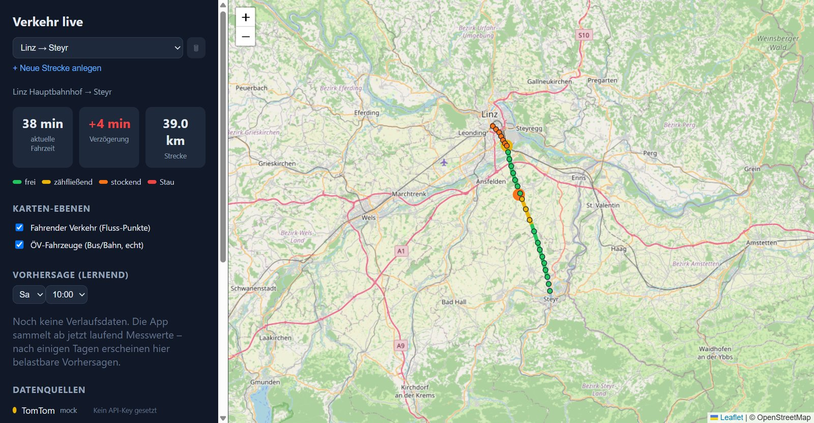
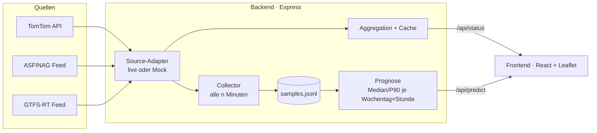

# TTJ: Live-Verkehrsdashboard mit lernender Fahrzeit-Prognose

Live-Karte für den Verkehr auf einer Pendelstrecke (Standard: Linz → Steyr).
Das Dashboard zeigt die aktuelle Fahrzeit, die Verzögerung und Staus pro Abschnitt. Im Hintergrund misst es
laufend mit und lernt daraus, **wann man am besten losfährt**.



## Warum

Navi-Apps sagen, wie lange es *jetzt* dauert. Für eine tägliche Pendelstrecke ist aber eine andere Frage
interessanter: *Wann lohnt es sich loszufahren?* TTJ sammelt dazu eigene Messwerte und baut daraus eine
Prognose je Wochentag und Uhrzeit, ganz ohne fremde Historien-API.

## Features

- **Live-Status**: Fahrzeit, Verzögerung gegenüber freier Fahrt und Länge; Abschnitte eingefärbt nach
  frei / zähfließend / stockend / Stau; Verkehrsmeldungen.
- **Lernende Prognose**: Ein Collector misst alle *n* Minuten die Fahrzeit jeder Route. Daraus entstehen
  Median und P90 je Wochentag × Stunde, die beste Abfahrtszeit in einem Zeitfenster und eine Wochen-Heatmap.
- **Mehrere Strecken**: Adresse suchen (Geocoding), Route speichern, per Dropdown umschalten.
- **Karten-Ebenen**: animierte Fluss-Punkte (bewegen sich mit dem echten Segment-Tempo) und echte
  ÖV-Fahrzeuge aus einem GTFS-Realtime-Feed.
- **Läuft ohne Keys**: Fehlt ein API-Key, liefert die jeweilige Quelle Mock-Daten. Sobald ein Key gesetzt
  ist, schaltet sie automatisch auf live.

## Tech-Stack

| Teil | Technologie |
|---|---|
| Backend | Node.js, Express, TypeScript (`tsx`), `gtfs-realtime-bindings` |
| Frontend | React 18, Vite, Leaflet / react-leaflet |
| Datenquellen | TomTom (Routing, Traffic Flow, Incidents, Geocoding), ASFINAG Open Data, GTFS-Realtime |
| Ablage | JSON / JSONL-Dateien (`backend/data/`), keine Datenbank nötig |

## Architektur



Das Frontend spricht nur mit dem Backend. **API-Keys liegen ausschließlich im Backend** (`backend/.env`) und
werden nie an den Browser ausgeliefert. Ein Cache (`CACHE_TTL_SECONDS`) schont die Rate-Limits der Anbieter.

## Schnellstart

Voraussetzung: Node.js ≥ 20.

```bash
npm run install:all                      # installiert Root, Backend und Frontend
cp backend/.env.example backend/.env     # optional: Keys eintragen, sonst Mock-Daten
npm run dev                              # startet Backend und Frontend gemeinsam
```

- Frontend: <http://localhost:5173>
- Backend: <http://localhost:3001/api/status>

## Konfiguration (`backend/.env`)

| Variable | Zweck | Leer gelassen |
|---|---|---|
| `TOMTOM_API_KEY` | Routing, Flow, Meldungen, Geocoding ([developer.tomtom.com](https://developer.tomtom.com/), 2.500 Requests/Tag kostenlos) | Mock-Daten, Adresssuche aus |
| `ASFINAG_FEED_URL` | ASFINAG-Open-Data-Feed (A1/A9) | Mock-Daten |
| `GTFS_RT_URL` / `GTFS_RT_HEADER` | GTFS-Realtime-VehiclePositions-Feed, optional mit Auth-Header | ÖV-Ebene bleibt leer |
| `PORT` | Backend-Port | `3001` |
| `CACHE_TTL_SECONDS` | Cache-Dauer der Live-Abfragen | `60` |
| `COLLECT_INTERVAL_MIN` | Messintervall des Collectors | `10` |

## API

| Methode | Pfad | Zweck |
|---|---|---|
| GET | `/api/routes` | Routen auflisten |
| POST | `/api/routes` | Route anlegen (`{origin, destination, name}` oder `{originQuery, destQuery}`) |
| DELETE | `/api/routes/:id` | Route löschen |
| GET | `/api/geocode?q=` | Adress-Vorschläge |
| GET | `/api/status?routeId=` | Live-Status (Route, Reisezeit, Segmente, Meldungen) |
| GET | `/api/predict?routeId=&dow=&hour=` | Prognose aus der eigenen Messhistorie |
| GET | `/api/vehicles?routeId=` | ÖV-Fahrzeuge (GTFS-RT) |

## Projektstruktur

```
ttj/
├── backend/
│   └── src/
│       ├── sources/      Adapter: tomtom, asfinag, gtfs, mock
│       ├── collector.ts  periodische Messung
│       ├── predict.ts    Prognose (Median/P90, beste Abfahrt, Heatmap)
│       └── index.ts      Express-API
├── frontend/
│   └── src/components/   Karte, Fluss-Punkte, ÖV-Layer, Routenwahl, Prognose-Panel
└── docs/                 Screenshot
```

## Status

Funktionsfähiger Prototyp für den Eigengebrauch. Die Prognose wird erst nach einigen Tagen Datensammlung
belastbar, dafür sollte das Backend möglichst durchlaufen.

Ideen für später: Deployment als Dauerdienst, Push-Hinweis „jetzt losfahren", Wetter als zusätzlicher Faktor.

## Lizenz

Noch offen.
